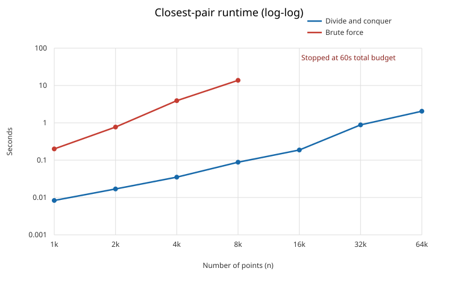

# Assignment 2: Closest Camera Traps

AI use: Copilot assisted with implementing and testing the algorithms. I verified
the results against brute force on the required edge cases and 500 random inputs.

## Implementation and recurrence

The divide-and-conquer implementation sorts points by x and y, splits by x,
solves each half, and checks a y-ordered strip around the split. It compares
only the next seven strip points, giving linear work to combine the halves.
Coordinates are squared during comparisons; the square root is taken only for
the returned distance. Returned indices refer to the original input, and ties
are resolved by the smallest `(i, j)` pair. Duplicate coordinates are handled
explicitly.

Sorting takes `Theta(n log n)`. Each recursive call partitions its y-order in
`Theta(n)` and scans a bounded number of strip neighbors, so
`T(n) = 2T(n/2) + Theta(n)`. By the Master Method (`a=2`, `b=2`, `f(n)=Theta(n)`),
`T(n) = Theta(n log n)`. The brute-force algorithm checks all pairs and takes
`Theta(n^2)` time.

## Measurements

Python 3.12.4 on a 13th Gen Intel Core i7-1355U; fixed-seed random integer
coordinates in `[0, 1,000,000)`. Divide-and-conquer times are medians of three
runs; brute force was run once per size. Brute-force worker time was capped at
60 seconds total across sizes; the 16,000-point run was stopped when that
budget expired.

| n | Divide and conquer (s) | Brute force (s) |
|---:|---:|---:|
| 1,000 | 0.008344 | 0.200398 |
| 2,000 | 0.016933 | 0.771039 |
| 4,000 | 0.035109 | 3.925501 |
| 8,000 | 0.088085 | 13.742336 |
| 16,000 | 0.187485 | stopped at total time budget |
| 32,000 | 0.881502 | not run |
| 64,000 | 2.048360 | not run |

The divide-and-conquer method was faster at the smallest tested size,
`n = 1,000`; this is the smallest observed crossover on the requested size
sequence, not a search for the exact crossover between 2 and 1,000 points.

## Critical reflection

The divide-and-conquer measurements generally followed the expected
`n log n` trend, while brute force grew much more quickly, consistent with
`n^2`. The growth is not perfectly smooth: random point distribution, process
startup, operating-system scheduling, and the small number of timing repeats
affect wall-clock measurements. The brute-force run also reached the experiment's
60-second total budget before larger sizes could be measured.

Brute force can still win on small inputs because it does little setup and
uses simple nested loops. The divide-and-conquer method sorts twice and
allocates and partitions lists and sets recursively; those constant costs can
outweigh its asymptotic advantage at small `n`. In this run it was already
faster at the smallest requested size, but that result does not imply the
crossover is below every machine's timing resolution or setup costs.

The strip crossing the divide was an important edge case: independently
solving each half could miss the closest pair. A focused test put the winning
pair on opposite sides, and 500 seeded random cases were also compared against
the brute-force result.
