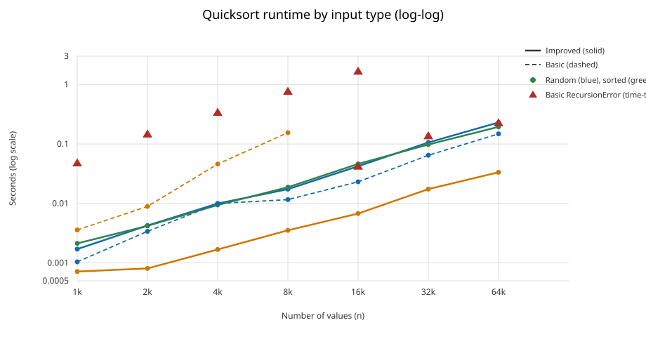
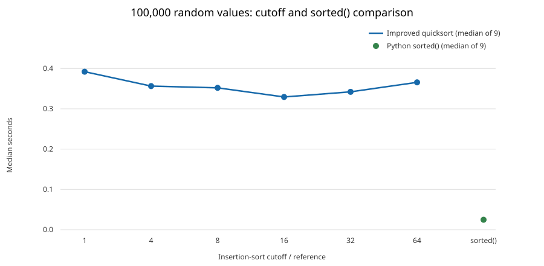

# Assignment 3: Fixing a Slow Quicksort

**AI use:** Copilot assisted with implementing and testing both sorting
algorithms and preparing the benchmark. I checked results against Python's
`sorted()` on the required edge cases and 500 seeded random lists.

## Implementation and analysis

`quicksort_basic` uses the last element as the Lomuto pivot and recursively
sorts both partitions. On already sorted or reverse-sorted input, that pivot
is an extreme value, leaving one partition empty and the other with `n - 1`
values. Thus `T(n) = T(n - 1) + Theta(n) = Theta(n^2)`, with recursion depth
`Theta(n)`; Python raises `RecursionError` on these inputs. Lomuto also handles
equal values poorly because values equal to the pivot all fall on the same
side.

`quicksort_improved` chooses a random pivot, partitions into less-than,
equal-to, and greater-than groups, and uses insertion sort for partitions up
to the cutoff. Three-way partitioning handles repeated amounts efficiently.
It recursively sorts the smaller outer partition and iterates over the larger,
bounding stack depth by `O(log n)`. Expected sorting time is `O(n log n)` for
randomized pivots; insertion sort is effective on the small partitions.

## Part C1: Timings by input type

Python 3.12.4, 13th Gen Intel Core i7-1355U. Random values use a fixed seed;
sorted input is ordered random data; duplicate-heavy input uses values 0–9.
Improved-sort times are medians of three runs. Basic-sort times are one run,
executed in a subprocess so recursion failures could be recorded. Its reported
failure times measure time until the exception, not the time for a complete
sort. A basic-sort run was stopped after 3 seconds and recorded as a timeout.
Input generation and process startup are excluded from function timings.

### Random input

| n | Basic quicksort (s) | Improved, cutoff 16 (s) |
|---:|---:|---:|
| 1,000 | 0.001043 | 0.001706 |
| 2,000 | 0.003392 | 0.004258 |
| 4,000 | 0.009962 | 0.009993 |
| 8,000 | 0.011570 | 0.017330 |
| 16,000 | 0.023083 | 0.042199 |
| 32,000 | 0.064488 | 0.105448 |
| 64,000 | 0.147756 | 0.226903 |

### Already sorted input

| n | Basic quicksort | Improved, cutoff 16 (s) |
|---:|---:|---:|
| 1,000 | RecursionError (0.055829 s) | 0.002134 |
| 2,000 | RecursionError (0.171538 s) | 0.004613 |
| 4,000 | RecursionError (0.395844 s) | 0.009406 |
| 8,000 | RecursionError (0.894097 s) | 0.019338 |
| 16,000 | RecursionError (1.945395 s) | 0.040318 |
| 32,000 | Timeout (>3 s) | 0.095822 |
| 64,000 | Timeout (>3 s) | 0.201092 |

### Duplicate-heavy input

| n | Basic quicksort | Improved, cutoff 16 (s) |
|---:|---:|---:|
| 1,000 | 0.003577 s | 0.000716 |
| 2,000 | 0.008888 s | 0.000798 |
| 4,000 | 0.045978 s | 0.001682 |
| 8,000 | 0.154759 s | 0.003653 |
| 16,000 | RecursionError (0.049182 s) | 0.006683 |
| 32,000 | RecursionError (0.159798 s) | 0.017063 |
| 64,000 | RecursionError (0.263795 s) | 0.033752 |

The log-log plot shows successful runtimes and improved-sort results. Triangle
markers indicate the basic version raised `RecursionError`; their coordinates
are time-to-failure, not completed sorts. Timeouts are listed in the tables.

## Part C3–C4: Cutoff and Python comparison

For 100,000 fixed-seed random integers, each improved-sort result is a median
of nine runs. The best tested cutoff on this machine was **16**.

| Cutoff | Improved quicksort (s) |
|---:|---:|
| 1 | 0.392038 |
| 4 | 0.356330 |
| 8 | 0.352108 |
| **16** | **0.329399** |
| 32 | 0.341981 |
| 64 | 0.365660 |
| Python `sorted()` | 0.024756 |

Python's `sorted()` was about 13.3 times faster in this run. Both have
`O(n log n)` expected/asymptotic behavior on these data, but Python's built-in
sort is implemented in optimized native code and benefits from TimSort's
handling of natural runs; the assignment implementation executes Python-level
partition and swap loops.

## Critical reflection

1. Basic quicksort failed on ordered data because its last-element pivot was
   repeatedly the largest or smallest element. The expected average-case
   behavior assumes partitions are reasonably balanced; the ordered input
   violated that assumption. Repeated values also led to unbalanced partitions.
2. Insertion sort is quadratic overall, but these quicksort subarrays are
   bounded by the cutoff. On small arrays its simple loop avoids recursive
   calls and partition overhead, making it a useful base case.
3. The tested cutoff of 16 was fastest in the nine-run median on this machine.
   The Python built-in was about 13.3 times faster, largely because `sorted()`
   uses optimized native implementation rather than Python-level loops. This
   ratio is a measurement for one machine and input, not a universal constant.
