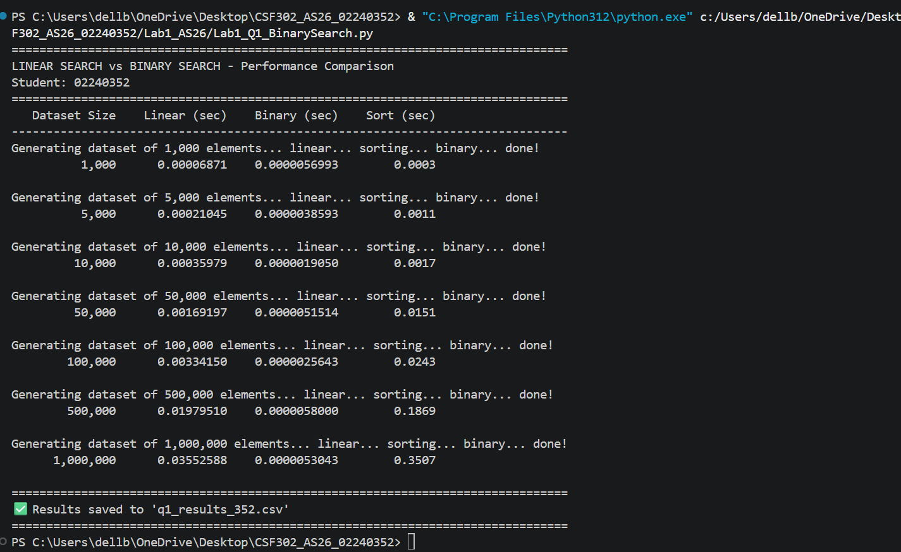
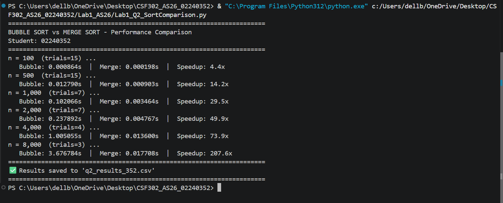
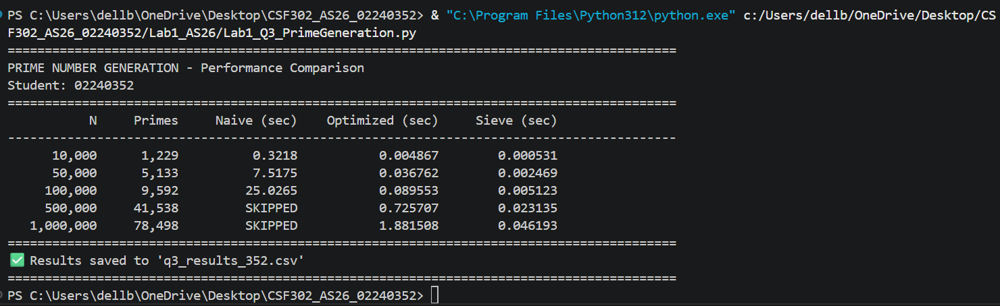

# Lab 1 - Algorithm Performance Analysis
**Student Number:** 02240352  
**Course:** CSF302 | **Assignment:** AS2026

---

## Question 1: Linear Search vs Binary Search
**File:** `Lab1_Q1_BinarySearch.py`

### Output Screenshot
<!-- Insert Q1 terminal output screenshot here -->

---

## Question 2: Bubble Sort vs Merge Sort
**File:** `Lab1_Q2_SortComparison.py`

### Output Screenshot
<!-- Insert Q2 terminal output screenshot here -->

---

## Question 3: Prime Number Generation Comparison
**File:** `Lab1_Q3_PrimeGeneration.py`

### Output Screenshot
<!-- Insert Q3 terminal output screenshot here -->

