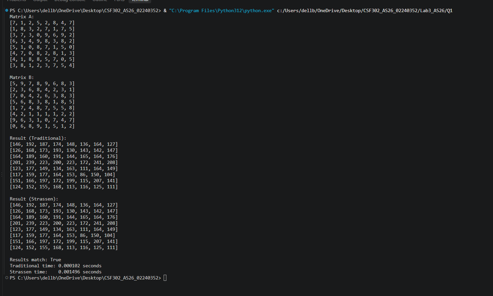
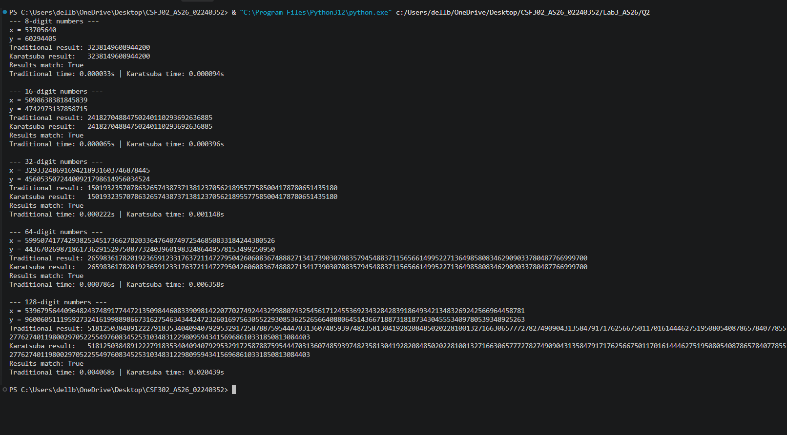
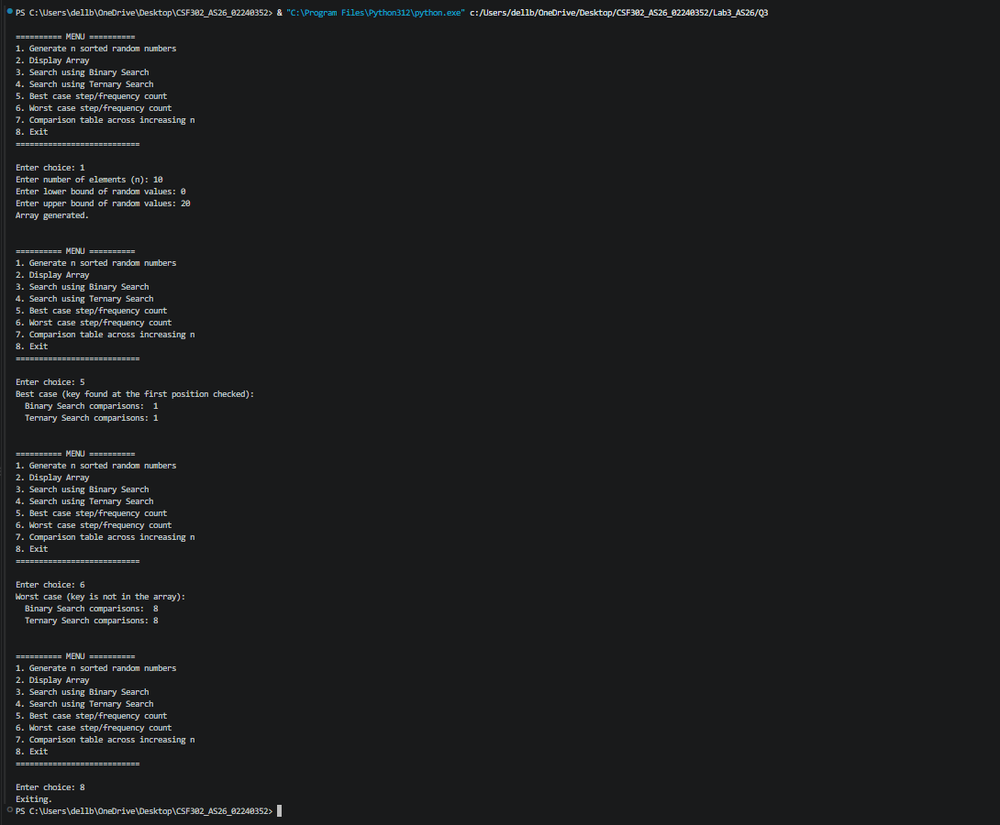

# Lab 3

**Student Number:** 02240352  

---

## Question 1: Matrix Multiplication — Strassen's vs Traditional

The program multiplies two square matrices using the traditional triple-loop method and Strassen's divide-and-conquer method. It prints both results, compares them, and records the running time of each algorithm.

### Output Screenshot

### Reflection

This question showed me that Strassen's algorithm reduces the number of recursive multiplications from eight to seven, but it also needs many matrix additions and recursive calls. For the small matrix size used in the program, the traditional method may still be faster because it has less overhead. The matching results confirmed that both methods produce the same answer.

---

## Question 2: Karatsuba's Algorithm for Large Integer Multiplication

The program multiplies large numbers represented as strings. It compares ordinary digit-by-digit multiplication with Karatsuba's divide-and-conquer method and checks that their answers match for several input sizes.

### Output Screenshot

### Reflection

Karatsuba's method was useful because it replaces four recursive multiplications with three. This improves the asymptotic running time for large numbers, although the extra splitting and recursive work can make the method less noticeable for small inputs. Using strings also made it possible to demonstrate the algorithm without depending on fixed-size integer types.

---

## Question 3: Binary Search vs Ternary Search (Menu-Driven Program)

This menu-driven program creates a sorted random array and lets the user display it, search with binary or ternary search, examine best and worst cases, and compare the number of comparisons for increasing array sizes.

### Output Screenshot

### Reflection

This question demonstrated that binary search usually needs fewer comparisons than ternary search even though both reduce the search space quickly. Ternary search checks two middle positions at each step, so the extra comparison does not necessarily provide an advantage. Counting comparisons made the difference between the two methods visible rather than relying only on their theoretical complexity.

---

